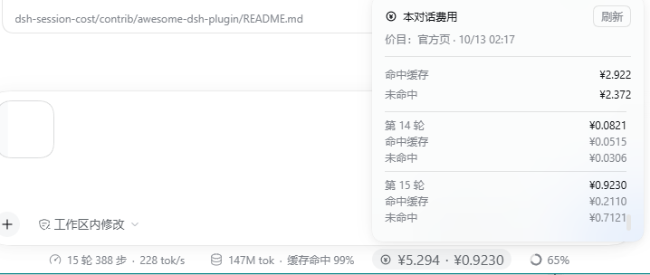

# dsh-session-cost

[English](README.md) | [中文](README.zh.md)

A **session cost** chip for [DeepSeek Harness](https://github.com/deepseek-ai/deepseek-harness): it sits in the same row as the built-in stats pills under the composer and answers "what has this conversation cost" and "what did the last turn cost" at a glance, splitting the spend into **cache-hit** and **cache-miss** parts.



## Install

### Option 1 — let your AI install it (recommended)

Paste this whole block into any AI that can read and write your machine (an agent inside DSH, Claude Code, Codex — anything):

```text
Install the DSH plugin at https://github.com/LanFeng97/dsh-session-cost into my DeepSeek Harness:
clone the repo, run `node tools/install.mjs`, and tell me when I need to restart DSH.
```

### Option 2 — from the plugin market (once listed)

DSH plugins are distributed as packages; look for **dsh-session-cost** in [dshmarket](https://github.com/dsh-market/dsh-market). Until it is listed, use option 1 or 3.

### Option 3 — manual install

```sh
git clone https://github.com/LanFeng97/dsh-session-cost
cd dsh-session-cost
node tools/install.mjs
```

That copies the package into your DSH profile's `node_modules` and appends one loader line to the profile's `cordis.patch.yml`. It resolves your DSH home the same way the harness does — `$DSH_HOME`, then `~/.dsh` — and it is idempotent: re-run it after pulling to sync an update.

```sh
node tools/install.mjs --dry-run        # print what it would do, write nothing
node tools/install.mjs web              # target another profile (default: desktop)
```

**Then restart DeepSeek Harness.** The host half is a Node module, so a config reload alone will not import it. After that, changing `lib/client.js` only needs a page refresh; changing `lib/index.js` still needs a restart.

Installing by **copy** rather than a directory junction is intentional: on Windows a junction is realpath-resolved back into the clone, and the plugin's `zod` import would then resolve from the clone directory, where there is no `node_modules` — the plugin would fail at load time.

A manual copy install **does not bring dependencies**: the host half needs `zod` for the projection schemas. A market / npm install brings it along; if your profile has no `zod` when installing manually, `tools/install.mjs` says so explicitly (without it the plugin fails at load time) — add it once, as the message tells you:

```sh
cd <your profile directory> && pnpm add zod
```

## How to read the UI

In the screenshot: the panel is the expanded part, and the strip at the very bottom is the **stats row under the composer** (the chip lives in the same row as the built-in session-stats and token-usage pills).

**The chip in the stats row**

```
◎ ¥2.922 · ¥0.4877
  ↑ left                ↑ right
this conversation's     the latest turn's
total spend             spend
```

- The **left** number is what this conversation has cost so far; the **right** number is what the most recent turn cost. Both update live as the conversation goes on.
- With nothing billable yet, the chip is hidden — the same "no content, no render" behaviour as the built-in stats pills.

**Click the chip and the panel opens upward**

- **Fixed header**: the conversation's total spend, split into **cache-hit** and **cache-miss** (`¥1.609` and `¥1.313` in the screenshot). Those two always add up to the total on the chip — the identity `total = hit + miss` holds by construction, not by rounding luck.
- **Scrolling list**: **every turn's** spend, three rows each — **total / cache-hit / cache-miss** (turns 7 and 8 in the screenshot). It starts at the newest turn; **scroll up** to walk back through earlier ones.
- **The scrolling window is exactly two turn blocks tall** — you came here to see this turn and the previous one, and the panel does not have to grow tall for that.

**The 刷新 (Refresh) button, top right**

It is about the **price list used for pricing**, not about re-counting your conversation. Clicking it makes the host fetch the **official Chinese price page**, parse its 12 unit prices and validate every one, then **show you the diff first** (which line changed, from what to what) — nothing is applied until you click **采用 (Apply)**. That extra step exists because DeepSeek publishes **no machine-readable price API**, only a human-facing docs page, so parsing it can fail; a bad parse applied silently would corrupt every number you look at.

The panel's second line — `价目：官方页 · 10/13 02:17` — tells you **which price list is active and when it was fetched**. If it says `价目：内置表`, no fetch has happened yet and the built-in table shipped with the plugin is in use.

**Do you need to click it often?** No. Once when the official prices change. After you apply, **the whole conversation is instantly re-priced** (money is computed in the browser from the active price list; history stores only token facts), so you never end up with two generations of prices mixed into one ledger.

## Where the numbers come from

Only the **official DeepSeek routes** have a published price list, so only they produce money:

| | |
| --- | --- |
| **Hit spend** | cache-read tokens × hit price |
| **Miss spend** | (uncached input + cache-write) × miss price **+** output tokens × output price |
| **Peak / off-peak** | Beijing time Mon–Fri 09:00–12:00 and 14:00–18:00 are peak (double price); weekends and Chinese public holidays are off-peak all day |
| **When it is priced** | At the instant each call happened, taken from the session event's own timestamp — so replaying months-old history is priced with the tariff of *that* moment, not today's |
| **Other providers** | Never guessed at ¥0: they show as *unpriced*, and the panel reports how many calls were unpriced |

Scope is the **current conversation's own turns**. A subagent is a different session and is deliberately not folded in, so the chip's numbers line up one-to-one with the turns you can see.

### It is an estimate, not a bill

Prices are estimated from token counts and the published tariff. The plugin never reads your balance, never touches credentials, and cannot see what DeepSeek actually deducted.

### The `deepseek-v4-pro` tier is disputed

The price rules carry a time fence — a rule **copied into this plugin's source** in the same spirit as [`@linxin666/dsh-usage`](https://github.com/zhu1090093659/dsh-web) (a provenance note, not a runtime dependency — see "No runtime coupling" below): **after 2026-09-14 12:00 Beijing, `deepseek-v4-pro` requests are billed at the Flash row.**

The official price page still lists `deepseek-v4-pro` on **its own, 3–7.5× more expensive row** (miss 4.5/9.0, output 13.5/27.0). The documentation cannot prove which tier the runtime actually charges. Rather than guess, the plugin keeps the fence and **marks the affected turns** with `按Flash档估`, plus a summary line in the panel. To price them at the official pro row instead, set `V4_PRO_FOLDED_INTO_FLASH_AT_MS` in `lib/pricing.js` to `0`.

## The full price-refresh flow

1. The host fetches the **official Chinese price page** (`api-docs.deepseek.com/zh-cn/quick_start/pricing`, which quotes CNY; the English page quotes USD and is not used).
2. It parses the table and validates all 12 unit prices — if any single one is missing or implausible, the whole parse is rejected.
3. It shows you **the diff**; **采用 (Apply)** commits it, **放弃 (Discard)** throws it away.

The price list is stored in `<DSH_HOME>/dsh-session-cost/pricebook.json` (atomic write) and survives restarts. A failed fetch (offline, timeout, redesigned page) is reported and **keeps the current prices**; the built-in table remains the first-run fallback.

### Capability boundary

- **One outbound request**, to the public docs page above, **only when you click 刷新**. Nothing else ever leaves the machine.
- **One file written**: `<DSH_HOME>/dsh-session-cost/pricebook.json`.
- The three price routes are **loopback + same-origin fenced** (the same guard sibling DSH plugins use).
- The host half reads no credentials, writes no session data, and runs no timers.

## How it works

### Official extension points, not DOM injection

- The chip registers into the built-in slot **`conversation.composer.dock`** (`order: 1`; the shipped `stats` pills take `order: 0`). That slot *is* the stats row under the composer, a `display:flex; gap:12px` row, so the chip is a first-class sibling of the built-in pills — no DOM poking, no fight with re-renders.
- The panel reuses `useAnchoredPosition` and `useDismissOnOutsidePointer` from `@deepseek-ai/dsh-client-ui-primitives`, the same pair the built-in stats dialogs use, so placement, clamping, outside-click and Esc behave identically.
- All styling goes through theme CSS variables (`--dsw-*`), so it follows your theme instead of hard-coding colors.

### Token facts travel as a session projection

The host registers a **session projection unit** (`sessionCost`) and the browser reads it with `useProjection('sessionCost')`. That buys three things for free:

- **History backfill.** The projection registry replays a late-registered unit over the in-memory log on first touch, so after installing or restarting DSH the turns that *already happened* in the current conversation are folded in — the chip does not start at ¥0.
- **Persistence.** State rides the harness's projection checkpoint cache, so the plugin writes no data files of its own.
- **Push, not polling.** Values arrive on the session control stream; there is no timer and no fetch loop.

### Layered so it can be tested without DSH

| File | Role |
| --- | --- |
| `lib/fold.js` | Pure fold: session events → per-turn token facts. Zero dependencies. |
| `lib/pricing.js` | Pure pricing: peak/off-peak clock, model→price-row decision, tokens→money. Zero dependencies. |
| `lib/pricebook.js` | Pure price book: built-in table, strict validation, official-page parser. Zero dependencies. |
| `lib/projection.js` | Thin adapter: zod schemas + the client view. |
| `lib/pricebook-store.js` | Fetch, stage a candidate, apply, persist. |
| `lib/routes.js`, `lib/guard.js` | Loopback-fenced HTTP translation. |
| `lib/client.js` | The chip and the panel; computes money from facts × the active book. |

## Tests

```sh
npm test              # node tools/selftest.mjs — 66 checks, no network
npm run test:live     # node tools/live-check.mjs — fetch the real page, parse, persist, read back
npm run test:schema   # node tools/schema-check.mjs — schema ↔ state ↔ view consistency, from the installed copy
```

`selftest` covers peak/off-peak and holiday exceptions, the parser (against a checked-in snapshot of the official page), price-book validation, re-pricing under a different book, per-bucket aggregation, replay idempotence, JSON-safe state, list trimming, and the client's i18n key set.

`test:schema` exists because `selftest` deliberately has no third-party imports (it must run without `node_modules`) and therefore **cannot see the zod schemas** — a mismatch between `viewOf()` and the view schema makes every projection read throw at runtime, and that seam did break once. It has its own guard now.

## Compatibility

- DSH **≥ 0.2.0-rc.2** (built and verified against 0.2.0-rc.2).
- Node **≥ 20**.
- One runtime dependency: `zod` ^4, for the projection schemas.

## License

[MIT](LICENSE) © 2026 LanFeng97.

Two pieces are not original to this plugin and keep their upstream credit:

- `lib/holidays.js` — Chinese public-holiday dates from [bastengao/chinese-holidays-node](https://github.com/bastengao/chinese-holidays-node) (MIT).
- The peak/off-peak rules and the price-row decision in `lib/pricing.js`, plus the built-in table in `lib/pricebook.js` — same tariff interpretation as [@linxin666/dsh-usage](https://github.com/zhu1090093659/dsh-web) (Apache-2.0).

### No runtime coupling

Both bullets above are **credits only**: the rules and data were **copied into this plugin's source**. This plugin does **not `import` dsh-usage, and does not import any `@linxin666/*` package**. Uninstall dsh-usage, upgrade it, rename it — this plugin keeps working. The flip side: when the official prices change, the two **copies** each need updating (that is what "same tariff interpretation" is warning about).

The only third-party runtime dependency is **`zod` ^4**, used for the projection schemas. A market / npm install brings it along; for the manual copy install, see the note in **Install** above.

## Related

- [dsh-workspace-create-dialog](https://github.com/LanFeng97/dsh-workspace-create-dialog) — the sibling plugin by the same author, for the Create Workspace dialog.
